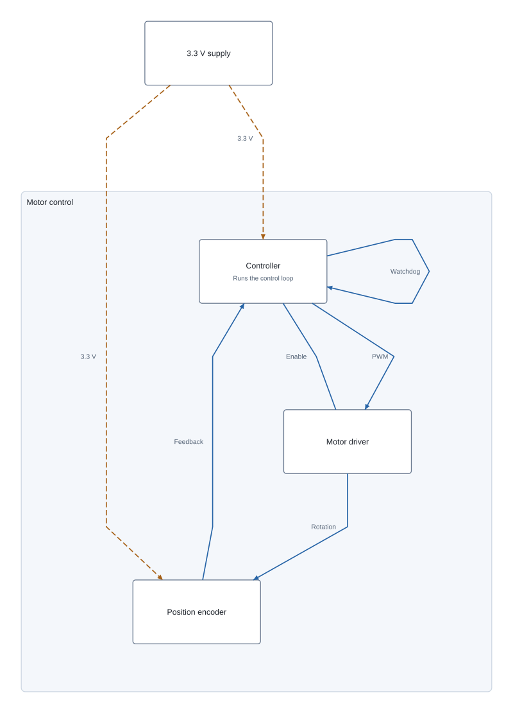
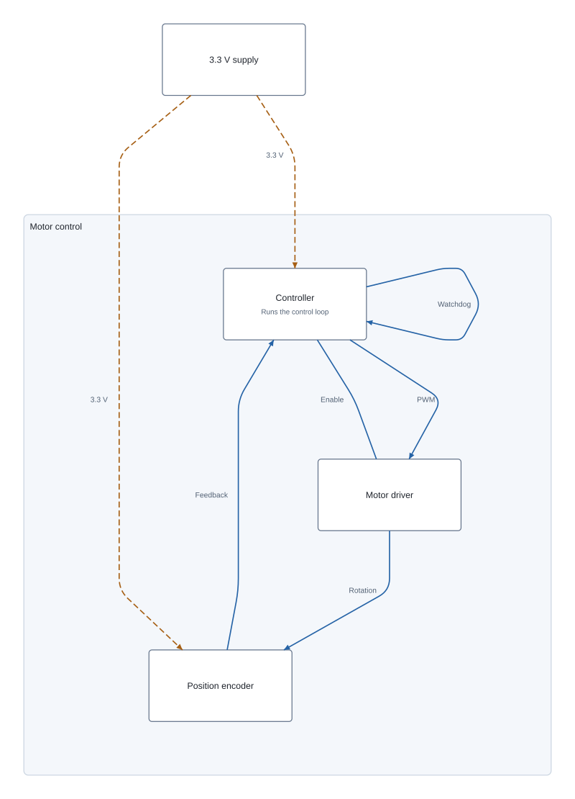

# Proposal: curved system block routes

Status: proposal only. These fields are not registered schemas yet, and current
core/circuit-to-svg releases still produce/render polylines.

## Proposed representation

Keep `system_block_connection.route` as an ordered array of endpoints. Add an
optional pair of absolute control points to the endpoint of a cubic segment:

```ts
interface SystemBlockRoutePoint extends Point {
  /** Controls the cubic segment from the previous route point to this point. */
  cubic_bezier_control_points?: [Point, Point]
}

interface SystemBlockConnection {
  // Other fields remain unchanged.
  route: SystemBlockRoutePoint[]
}
```

```json
{
  "route": [
    { "x": 0, "y": 0 },
    { "x": 12, "y": 0 },
    {
      "x": 18, "y": 6,
      "cubic_bezier_control_points": [
        { "x": 16, "y": 0 },
        { "x": 18, "y": 2 }
      ]
    },
    { "x": 18, "y": 24 }
  ]
}
```

This is a straight segment, a rounded turn, then another straight segment. The
first control point belongs to the departure from the previous endpoint; the
second belongs to the arrival at the current endpoint. Missing controls mean a
straight line. The first route point must not carry controls.

All endpoints and controls are **absolute page-local points in diagram mm**, with
the origin at page center, +X right and +Y up. Group membership introduces no
transform. The representation stores geometry, not an SVG path string, a
renderer-specific interpolation name, or an unresolved corner-radius request.

## Effect on the motor-control example

<table><tr><th>Current polyline</th><th>Proposed resolved curves</th></tr><tr>
<td></td>
<td></td>
</tr></table>

The [proposed connection records](./system-block-curved-routes.json) correspond
to the second image. They are a fragment referencing the unchanged blocks from
core's motor-control fixture, not a standalone Circuit JSON document. The image
is an illustrative SVG path rendering, not output from released circuit-to-svg.

The example inserts rounded transitions at internal bends, preserves endpoints,
and keeps labels at their existing `label_anchor_center`. Core could offer a
rounded-route option later; this proposal only defines its resolved output.

## Validation and rendering contract

- Every endpoint and control coordinate must be finite. A control tuple has
  exactly two points; partial tuples, nulls, and controls on the first point fail.
- A route still needs at least two points. Equal consecutive endpoints are
  allowed only for a cubic with at least one different control point, permitting
  a closed self-loop. A straight zero-length segment or fully collapsed cubic
  remains invalid.
- For `P0` (previous endpoint), `P1` and `P2` (controls), and `P3` (endpoint), use
  `B(t) = (1-t)^3 P0 + 3(1-t)^2 t P1 + 3(1-t)t^2 P2 + t^3 P3`, `0 <= t <= 1`.
  An SVG consumer translates this to `C`; lines translate to `L`. Apply the
  same page-to-SVG transform to controls and endpoints, including the Y flip.
- Arrowheads follow the curve tangent. At the end, use the first nonzero vector
  among `P3-P2`, `P3-P1`, and `P3-P0`; at the start use `P1-P0`, `P2-P0`, then
  `P3-P0`, reversing it for the source arrow. This handles coincident handles.
- Producers must include curve extents in page/group bounds. Bounding the whole
  control hull is conservative; tighter bounds use Bézier derivative roots.
  Renderers should not infer bends from the current viewport or zoom.
- `is_signal`, `is_power`, `direction`, and `label_anchor_center` do not change.
  Cubic handles do not move labels automatically. Rounded routes should be
  checked against blocks and headings after conversion.

## Compatibility and rollout

Existing point-only routes keep their meaning, and the new point interface is
structurally assignable to `Point`. Current consumers that read only `x` and `y`
display a fallback polyline through the anchors. An old schema parser may strip
the handles, so lossless round trips require a schema-aware version. A closed
single-segment loop is a deliberate exception: it requires the new validator and
has no useful old-renderer fallback; use distinct loop anchors during rollout.

1. Add/export `SystemBlockRoutePoint` and its Zod validator, then update connection
   validation and public-union round-trip tests.
2. Add `L`/`C` path rendering, tangent arrowheads, and snapshots in circuit-to-svg.
3. Let core resolve optional rounding into explicit control points after layout.
   Keep the original endpoints and re-check bounds/collisions.
4. Extend other diagram records only when a concrete consumer needs the same
   representation. This does not change physical PCB trace geometry.

Cubic segments cover smooth interfaces, rounded corners, and self-loops with one
primitive. Quadratic curves can be converted exactly to cubics; circular arcs can
be approximated within a documented tolerance. Additional arc/command types can
be considered separately if exact circular geometry becomes necessary.
