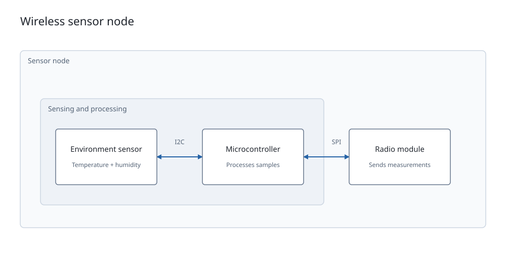

# Resolved system block diagrams

The `system_block_*` records describe a high-level system overview: functional
blocks, nested subsystem groups, and labeled relationships. They are the resolved
output of the [`systemblock` props API](https://github.com/tscircuit/props/pull/972).

**Layout is completed before emitting Circuit JSON.** Renderers draw supplied
bounds, connection routes, and label positions. They do not run a graph layout
algorithm, infer block dimensions, or resolve authoring names.

| Record | Required geometry |
| --- | --- |
| `system_block_page` | Positive finite `width` and `height` |
| `system_block_group` | Finite `center`, positive finite `width` and `height` |
| `system_block_component` | Finite `center`, positive finite `width` and `height` |
| `system_block_connection` | Ordered `route` of at least two finite points; `label_anchor_center` when `label` is supplied |

All records have their own matching `*_id`. Groups, components, and connections
also require `system_block_page_id`. Optional `name`, `display_name`, and (except
on connections) `description` retain authoring identity and explanatory text.
Consumers can display `display_name`, then `name`, then the element ID as fallback.

## Coordinates and bounds

All positions and dimensions are numeric **diagram millimeters**, with the origin
at the page center, +X right and +Y up. Diagram geometry is independent of physical
PCB positions and dimensions. Unit strings, nonfinite numbers, zero sizes, and
negative sizes are rejected. Geometry has no defaults: omitting a block's center,
width, or height is invalid, even if its text could be used to estimate them.

The page spans `[-width/2, width/2] × [-height/2, height/2]`. A block or group spans
`center.x ± width/2` and `center.y ± height/2`. The producer includes the intended
text and padding in the bounds; viewer styling must fit those resolved bounds.

Every group, including a nested group, uses absolute coordinates within its page.
`parent_system_block_group_id` records membership only. A component's
`system_block_group_id` identifies its immediate group. Omit either parent field
for a top-level element. Do not add parent centers or apply a second transform.
Parent and child bounds are both supplied rather than computed from one another.

For SVG with `viewBox="0 0 width height"`, map a point as:

```ts
const svgX = page.width / 2 + point.x
const svgY = page.height / 2 - point.y
// Block rectangle: x = svgX - width/2; y = svgY - height/2.
```

## Connections

`from_system_block_component_id` and `to_system_block_component_id` identify
components on the same page. These are IDs, not names, selectors, or electrical
ports. Connections may cross group boundaries and do not create nets or traces.

`route` contains the final endpoints in source-to-target order, including the
attachment points on the source and target block boundaries. Each endpoint may
have `cubic_bezier_control_points: [Point, Point]` to describe the cubic segment
arriving from the previous endpoint. Controls are absolute page-local coordinates,
in departure then arrival order. Omit them for a straight segment. The first
endpoint must not have controls. Each control tuple has exactly two finite points.

Routes need at least two endpoints. Equal consecutive endpoints are allowed only
for a cubic with at least one control different from that endpoint, supporting
closed self-loops. Straight zero-length segments and fully collapsed cubics fail.
The producer resolves attachment sides, intermediate bends, and controls;
renderers must not replace supplied geometry with an inferred shortest path.
See [curved routes and circular corners](proposals/system-block-curves.md) for a
radius-6 quarter-circle example, illustrations, and the rendering contract.

`is_signal` and `is_power` are required independent booleans. Both may be true
or both false; neither is inferred from the other. `direction` is explicitly
`forward` (arrow at the last route point), `both` (arrows at both ends), or `none`.
These fields have no schema defaults; core supplies their resolved values before emission.
Arrowheads follow the tangent of the first/last segment. Stroke and arrowhead styling is up to
the viewer, without moving the stored attachment points.

An optional `label` is preserved verbatim. Supplying a label, including an empty
string, requires a `label_anchor_center` for centered horizontal text. The producer
places the label; viewers do not infer its position from a route midpoint.

## Resolved PCB associations

Both components and groups may carry these optional fields:

| Authoring prop | Resolved Circuit JSON |
| --- | --- |
| `pcbComponentName` | One element in `pcb_component_ids` |
| `pcbComponentNames` | A nonempty `pcb_component_ids` array |
| `pcbSubcircuitName` | `pcb_group_id` identifying the resolved PCB subcircuit group |

When both fields are present, `pcb_component_ids` is the selected set within
`pcb_group_id`, not a request to select every component in the group. A lone
`pcb_group_id` associates the entire group; no fields means a conceptual block
without a PCB association. Group associations are not inherited by child records.

Name resolution belongs to the producer. This format does not retain PCB name
selectors, introduce duplicate singular ID fields, or require PCB records merely
to draw a diagram. Viewers may use resolved associations for cross-highlighting.

## Example and validation

[Complete example JSON](system-block-example.json) contains a page, nested groups,
three blocks, and two bidirectional interfaces. The snapshot below draws the
supplied geometry without running layout:



```ts
import { any_circuit_element, system_block_component } from "circuit-json"

system_block_component.parse({
  type: "system_block_component",
  system_block_component_id: "mcu",
  system_block_page_id: "overview",
  display_name: "Microcontroller",
  description: "Processes samples",
  center: { x: 0, y: -12 },
  width: 40,
  height: 22,
  pcb_component_ids: ["pcb_component_u3"],
})
// All four records also parse through any_circuit_element.
```

The package exports the four snake_case Zod validators, their `SystemBlock*`
interfaces, and `SystemBlock*Input` types. They participate in `AnyCircuitElement`,
`AnyCircuitElementInput`, and `CircuitJson` through the existing union.

Validation checks required fields, finite numeric geometry, positive sizes,
nonblank IDs/names (trimmed), nonempty PCB ID selections, nonzero route segments,
valid control tuples, label placement, and direct group self-parenting. It supplies no
layout, dimensions, IDs, routes, or styling defaults. Unknown keys are stripped
under the existing Zod object convention; there are no aliases or migrations.

Whole-document validation remains the producer/consumer's responsibility: IDs
must be unique, referenced pages/groups/components and PCB targets must exist,
membership must be acyclic and stay within a page, routes must attach to their
referenced blocks, and bounds must accommodate the intended content. Per-record
schemas do not look up foreign records or solve collisions/containment.

The package also exports `system_block_route_point`, `SystemBlockRoutePoint`, and
`SystemBlockRoutePointInput`. Cubic rendering in circuit-to-svg and circular-corner
generation in core require separate follow-ups.
